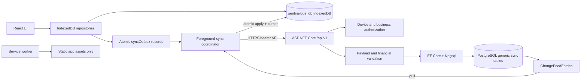

# SentinelOps Database and Storage Lifecycle Audit

**Audit date:** 2026-10-22  
**Scope:** Repository and safe local verification only. This baseline audit was followed by the implementation documented in [database-storage-remediation.md](database-storage-remediation.md).

## A. Executive Verdict

**SYNC FOUNDATION ONLY**

SentinelOps is currently an offline-first PWA. Business records are read and written from the browser's IndexedDB database `sentinelops_db`. An atomic IndexedDB outbox and an authenticated ASP.NET Core sync API exist. If a tablet is enrolled, the API is reachable, the API is connected to the intended PostgreSQL database, and the migrations have been applied, accepted mutations are persisted in PostgreSQL.

Cloud persistence is not verified for the live deployment. The repository does not prove that the owner's Neon database has been migrated, that the deployed API uses that Neon database, or that the current production PWA was built with the intended API. Existing records created before an outbox operation existed do not automatically migrate to the server; the remediation adds an explicit dry-run-gated cloud-import queue for staging and operator review.

The server's current design stores business payloads as generic JSON in `SyncEntities`, not typed `clients`, `invoices`, or `projects` tables. Therefore, an empty database with no `SyncEntities` or migration history indicates a schema/deployment problem; an empty database with only infrastructure tables can also simply mean no device has successfully registered or pushed data.

## B. Current Storage Architecture



The service worker does not proxy API calls, store credentials, or provide cloud persistence. The browser never connects directly to Neon.

## C. Entity-by-Entity Storage Matrix

| Entity/data type | UI entry point | Local service/repository | IndexedDB store | Outbox enqueue | Server persistence | Current status |
|---|---|---|---|---|---|---|
| Client | `src/features/clients/ClientsView.tsx` | `clientRepository.save/delete` | `clients` | Yes, atomic; save/delete also call `requestSync()` | `SyncEntities` JSON plus `ChangeFeedEntries`; no typed Client table | Sync foundation; cloud unverified |
| Settings | `src/features/settings/SettingsView.tsx` | `settingsRepository.saveSettings` | `settings` | Yes, allowlisted public profile; calls `requestSync()` | `SyncEntities` JSON | Sync foundation; cloud unverified |
| Quotation | `QuotationsView.tsx` | `quotationRepository.save/delete` | `quotations` | Yes, atomic | Generic `SyncEntities` JSON when pushed | Immediate post-commit sync signal; cloud unverified |
| Quotation revision | `QuotationsView.tsx` | `quotationRepository.createRevision` | `quotationRevisions` plus `quotations` | Yes for revision and updated quotation | Generic `SyncEntities` JSON | Immediate post-commit sync signal; cloud unverified |
| Invoice | `BillingView.tsx` | `invoiceRepository.save/voidInvoice` | `invoices` | Yes, atomic | Generic `SyncEntities` JSON after server validation | Immediate post-commit sync signal; cloud unverified |
| Payment | `BillingView.tsx` | `paymentRepository.recordPayment/reversePayment` | `payments`, updates `invoices` and sometimes `projects` | Yes for payment, invoice, and project changes | Generic `SyncEntities` JSON after server validation | Immediate post-commit sync signal; cloud unverified |
| Project | `ProjectsView.tsx` | `projectRepository.save/addProgressNote/delete` | `projects` | Yes, atomic | Generic `SyncEntities` JSON | Immediate post-commit sync signal; cloud unverified |
| Attachment metadata | Project attachment UI | `attachmentRepository.saveAttachment/deleteAttachment` | `attachments` | Yes for metadata only | Generic `SyncEntities` JSON metadata only | Immediate post-commit signal; blob is not uploaded |
| Attachment blob | Project attachment UI | `attachmentRepository` | `attachments` as browser `Blob` | No binary payload | No file/object storage endpoint | Local-only |
| Audit event | All relevant UI flows | `auditRepository` | `auditEvents` | No general outbox path | No server audit table/write path | Local-only |
| Local user/auth/session | Setup/login screens | `userRepository`, React session | `users` and memory | Never, intentionally | None | Local-only by design |
| Backup JSON/ZIP | Settings backup UI | `backupService` | Writes local stores only | Restore/merge does not enqueue imported records | None | Local portability, not cloud migration |
| Sync credentials/config | Settings Cloud Sync | `syncConfigRepository` | `syncConfig` | Not a business record | Device registration creates `Businesses`/`RegisteredDevices` | Enrollment required |
| Sync metadata/conflicts/outbox | Coordinator | sync repositories | `syncOutbox`, `syncMetadata`, `syncConflicts` | N/A | Idempotency, feed, tombstones, entities | Local protocol state |

### Local persistence and schema

`src/storage/database.ts` defines database `sentinelops_db`, current `DB_VERSION = 4`, and stores for users, settings, business entities, attachments, audit events, and sync state. Versioned upgrade logic creates the core stores and sync stores; the migration tests verify v1-to-v2 preservation and missing-store self-healing. Browser data survives reload/restart subject to normal browser site-data clearing and quota behavior. The app contains no `localStorage` or `sessionStorage` business-data path found by repository search.

## D. Why PostgreSQL Appears to Have No Tables

**Verified repository facts:**

- The API uses `UseNpgsql` in `server/SentinelOps.Api/Program.cs`.
- The model has five logical persistence areas: `Businesses`, `RegisteredDevices`, `SyncIdempotencyRecords`, `ChangeFeedEntries`, `EntityTombstones`, and `SyncEntities` in `server/SentinelOps.Api/Persistence/SentinelOpsDbContext.cs`.
- Migrations `20261020015531_InitialCreate` and `20261020030453_SyncProtocol` create those tables. They do not create typed business tables such as `Clients` or `Invoices`.
- `Program.cs` does not call `Database.Migrate()` or automatically apply migrations at startup.
- The Docker entrypoint only launches the API. The deployment runbook explicitly describes migration as a separate operator/deployment step.
- The production workflow is manual and now uses the protected `NEON_MIGRATION_CONNECTION_STRING` secret for schema changes, while `NEON_CONNECTION_STRING` is used for integration verification. Its execution history/secrets are not available in this audit.

**Most likely evidence-backed explanations, not confirmed remotely:**

1. The intended Neon database has never received the repository migrations. This would leave both the domain-independent sync tables and `__EFMigrationsHistory` absent.
2. The API, CI migration job, and owner's inspected Neon database use different connection strings, Neon branches, or databases. Repository configuration supports environment variables such as `ConnectionStrings__SentinelOps`, `DATABASE_URL`, and `DATABASE_CONNECTION_STRING`; their live values are not available here.
3. The database was migrated but has no pushed data because no device was enrolled, the PWA was not built with the intended API URL, or push requests failed. In that case infrastructure tables should exist, but `SyncEntities` may be empty.
4. The owner is looking for typed business tables. The current implementation intentionally uses `SyncEntities` with JSON payloads, so a missing `Clients` table is expected for this version.

**Unverified database state:** No Neon credentials or authorized read-only database connection were available. No SQL, `psql`, migration application, or remote API request was run. The following remain unverified: exact database identity, host/branch, schema, current tables, `__EFMigrationsHistory`, applied migration IDs, deployed API connection target, and whether any client row exists in `SyncEntities`.

Safe operator query, only after positively confirming the target database and using a read-only transaction:

```sql
BEGIN TRANSACTION READ ONLY;
SELECT current_database(), current_schema(), current_user,
       inet_server_addr(), inet_server_port(), version();
SELECT schemaname, tablename
FROM pg_catalog.pg_tables
WHERE schemaname NOT IN ('pg_catalog', 'information_schema')
ORDER BY schemaname, tablename;
SELECT to_regclass('public."__EFMigrationsHistory"');
SELECT "MigrationId", "ProductVersion"
FROM public."__EFMigrationsHistory"
ORDER BY "MigrationId";
COMMIT;
```

Do not include connection strings or tokens in chat or reports.

## E. Detailed Findings

### Critical — Unverified — Live Neon persistence and target identity

**Finding and impact:** The repository cannot prove that the deployed API and the database inspected by the owner are the same environment, or that migrations were applied there. A successful frontend/API build does not create PostgreSQL tables.

**Evidence:** `server/SentinelOps.Api/Program.cs` resolves connection strings from environment configuration; `server/SentinelOps.Api/Persistence/Migrations/*` contains migrations; `.github/workflows/ci.yml` applies Neon migrations only in a manual `deploy_production` workflow. No startup migration exists.

**Verification:** Unverified — access and deployment history unavailable.

**Recommended remedy:** Verify database identity and migration history read-only, then run an approved migration step against the confirmed target and record the applied IDs.

**Acceptance test:** Readiness reports the intended database as reachable; `__EFMigrationsHistory` contains both repository migrations; expected infrastructure tables are present; API and CI target fingerprints match.

**Existing-data risk:** Migration application is schema-changing and must be reviewed/backed up first. Do not run it as part of this audit.

### High — Verified — Browser remains the immediate source of truth

**Finding and impact:** Clients and all other business entities are read from IndexedDB. Cloud availability is conditional on enrollment, connectivity, configuration, and successful coordinator execution.

**Evidence:** `src/storage/database.ts`, `src/storage/repositories.ts`, `src/features/clients/ClientsView.tsx`, and `src/components/ui/SyncStatusWidget.tsx`.

**Verification:** Verified by code inspection and passing local outbox/migration tests.

**Recommended remedy:** Keep IndexedDB as an offline cache/outbox, but establish PostgreSQL as the shared authority only after a verified enrollment and server persistence workflow. Surface pending/failed state prominently.

**Acceptance test:** Create a client online and offline, observe an outbox item, observe an authenticated push, confirm server persistence, then pull it into a separate browser profile.

**Existing-data risk:** Changing authority or conflict rules can overwrite data if initial import and reconciliation are skipped.

### High — Verified — No initial IndexedDB-to-cloud migration

**Finding and impact:** Existing local records do not automatically appear in PostgreSQL merely because migrations or sync were later enabled. Backup restore and merge write local stores only and do not generate outbox operations.

**Evidence:** `src/services/backupService.ts` functions `restoreBackupData` and `mergeBackupData` write business stores directly; no server import endpoint, staging business scope, ID mapping, attachment transfer, or rollback workflow exists.

**Verification:** Verified by code inspection.

**Recommended remedy:** Implement a separate dry-run/import process that preserves UUIDs, orders relationships, validates totals, deduplicates document numbers, uploads attachments, reports conflicts, and requires explicit cutover approval.

**Acceptance test:** Import a preserved tablet backup into a staging business, compare counts/totals/relationships/checksums, rerun idempotently, and prove the source tablet remains unchanged.

**Existing-data risk:** High. Never clear local IndexedDB until server counts and representative records are reconciled.

### High — Verified — Server stores generic JSON, not typed business aggregates

**Finding and impact:** `SyncEntities` can durably contain a client payload, but PostgreSQL cannot enforce relational client/invoice/payment/project constraints or provide typed reporting from domain tables. Seeing no `Clients` table is expected under the current model.

**Evidence:** `SentinelOpsDbContext`, `Domain/Entities.cs`, `SyncController.Push`, and migrations create `SyncEntities` with `PayloadJson` as `jsonb`.

**Verification:** Verified by code inspection.

**Recommended remedy:** For production financial operations, introduce typed aggregates/tables and domain commands or explicitly document and test the generic JSON model as the supported contract.

**Acceptance test:** Push a client and invoice, inspect the intended server rows and constraints, retry the same operation ID, and verify tenant isolation and financial invariants in PostgreSQL integration tests.

**Existing-data risk:** Schema conversion needs a tested backfill and rollback plan.

### High — Partially fulfilled — Mutation-triggered sync is inconsistent

**Finding and impact:** Client and settings mutations dispatch `requestSync()` and therefore attempt immediate foreground sync. Quotations, revisions, invoices, payments, projects, and attachments enqueue atomically but do not dispatch `requestSync()`; they wait for the configured timer, an online event, enrollment, or manual sync.

**Evidence:** `src/storage/repositories.ts` imports `requestSync`; repository search finds calls at the settings and client paths only. `src/services/syncCoordinator.ts` starts its interval from `initialize()`, which is invoked by `SyncStatusWidget`.

**Verification:** Verified by code inspection; outbox unit tests do not prove a real HTTP push.

**Recommended remedy:** Centralize mutation notification after successful transaction commit for all supported repositories, or explicitly rely on and test the timer. Preserve outbox durability regardless.

**Acceptance test:** For every supported entity, create/update/delete while online and assert one authenticated push without manual UI action; repeat offline and after reconnect.

**Existing-data risk:** Low for trigger wiring; pending records may be sent sooner after deployment.

### Medium — Partially fulfilled — Pull and resynchronization gaps

**Finding and impact:** Pulled changes and cursor advancement are applied atomically in IndexedDB, but the API currently returns `resyncRequired = false` by default and has no visible retention-window check. Tombstone deletion metadata is not populated with the change-feed sequence, and snapshot handling omits attachments.

**Evidence:** `SyncController.Changes`, `SyncController.Push`, `SyncCoordinator.applyChangesAtomically`, `recoverFromSnapshot`, and `EntityTombstone`.

**Verification:** Atomic local behavior is covered by code/tests; stale-cursor production behavior is unverified.

**Recommended remedy:** Implement retention-aware cursor validation, explicit resync response, complete tombstone sequencing, snapshot pagination, and attachment reconciliation.

**Acceptance test:** Expire a cursor in a disposable PostgreSQL database, receive resync, preserve pending local edits, apply a complete snapshot, and replay them with conflict results.

**Existing-data risk:** Snapshot recovery can replace local records; require backup and conflict reporting.

### Medium — Verified — Attachments are metadata-only on the server

**Finding and impact:** Attachment blobs remain in IndexedDB. The outbox sends metadata only, and there is no authenticated upload/download/object-storage path. A synchronized attachment row does not mean the file is available to another tablet.

**Evidence:** `attachmentRepository.saveAttachment` explicitly builds a metadata payload; `SyncController` accepts `Attachment` JSON only; no upload controller or file storage abstraction is present.

**Verification:** Verified by code inspection.

**Recommended remedy:** Add private object storage, authenticated resumable upload/download, checksum and size/type validation, and a complete-state indicator.

**Acceptance test:** Upload a photo from one tablet, verify checksum and authorization, download it on another, and exercise retry/resume.

**Existing-data risk:** Existing local blobs need a separately verified inventory and upload migration.

### Medium — Verified — Financial server validation is payload-level, not domain persistence

**Finding and impact:** The API validates selected invoice/payment/quotation fields and balance invariants before writing JSON, but it does not maintain typed payment ledger rows or server-side aggregate relationships.

**Evidence:** `SyncController.ValidateDomainOperation` and `SyncEntities` persistence.

**Verification:** Verified by code inspection; no PostgreSQL HTTP integration test ran locally.

**Recommended remedy:** Move financial facts to append-only typed commands/aggregates with server-calculated balances and database constraints.

**Acceptance test:** Concurrent payment/reversal/retry tests prove no duplicate deduction and no invalid balance under real PostgreSQL transactions.

**Existing-data risk:** High; migration must reconcile existing invoice/payment JSON first.

### Low — Verified — Local authentication is intentionally not cloud authentication

**Finding and impact:** The local PBKDF2 vault user is device-local and is not a cloud account. This is appropriate for offline local security, but enrollment/device bearer credentials are a separate operational responsibility.

**Evidence:** `src/app/providers/AuthContext.tsx`, `src/features/auth/SetupScreen.tsx`, `DeviceController`, and `SyncConfig`.

**Verification:** Verified by code inspection.

**Recommended remedy:** Define credential rotation/expiry and operator recovery procedures before multi-tablet rollout.

**Acceptance test:** Revoke a device, confirm push/pull fail, rotate credentials, and verify no local password material is transmitted.

**Existing-data risk:** Revocation can strand unsent outbox records; preserve and re-enroll deliberately.

## F. What Actually Happens Today

### Create client while online

1. `ClientsView.handleSaveClient` calls `clientRepository.save`.
2. The repository writes the client, audit event, and `syncOutbox` upsert in one IndexedDB transaction.
3. It calls `requestSync()`. The coordinator receives the event only after it has been initialized and has a valid `syncConfig`.
4. The coordinator pushes up to 100 operations to `/api/v1/sync/push` with the enrolled device bearer token.
5. The server authenticates the device, validates the payload, writes `SyncEntities`, `ChangeFeedEntries`, and `SyncIdempotencyRecords` in one database transaction, then returns `accepted`.
6. The coordinator removes the acknowledged outbox item. This entire path is conditional; the repository alone proves only local persistence and queuing.

### Create client offline and reconnect

The client and outbox are committed locally. The coordinator reports offline. On the browser `online` event, or the next configured timer/manual action, it pushes the pending operation. If the device is not enrolled, it remains local-only.

### Other entity mutations

Quotation, revision, invoice, payment, project, and attachment mutations enqueue operations atomically and now request a best-effort sync after commit. The coordinator timer, online event, enrollment, or manual Sync action remains the recovery path if the event is missed. Audit events themselves are not synced.

### Pull from another tablet

The coordinator calls `/api/v1/sync/changes`, validates the cursor, applies mapped payloads and the new cursor in one IndexedDB transaction, and does not create new outbox records for pulled changes. Unknown entity types are skipped. There is no verified live two-browser HTTP test.

### Conflict, retry, and deletion

The server compares the operation base revision and returns `conflict` for stale edits. The client stores a conflict record and removes the operation from the outbox. Failed results remain with incremented attempts. Deletes remove the current generic entity and create/update a tombstone plus change-feed delete. The server has no general UI/API path to resolve a conflict by choosing or merging a typed domain value.

### Initial local-to-cloud migration

The remediation adds an explicit `queueBackupForCloudImport` path and a Settings action. It runs the existing dry run, rejects missing relationships and document-number collisions, queues supported records into the outbox without replacing local stores, and leaves attachment bytes local. It is not production-verified and does not replace the need for server reconciliation, typed financial persistence, or rollback testing.

## G. Verification Log

Commands executed in this audit:

- `git status --short --branch` -> `## main...origin/main`; clean working tree before the report.
- Read-only repository searches and file inspection -> completed; `rg` was unavailable, so `grep`/`find` were used where needed.
- `npm run lint` -> passed (`tsc --noEmit`).
- `npm test -- --run` -> passed: 6 files, 32 tests.
- `npm run build` -> passed; Vite produced `dist` and PWA assets. One non-failing large-chunk warning was emitted.
- `dotnet build server/SentinelOps.Api/SentinelOps.Api.csproj --no-restore` -> not completed: `NETSDK1004`, missing `server/SentinelOps.Api/obj/project.assets.json`.
- No `dotnet restore` was run because this audit was required to avoid installing/changing dependencies.
- No `dotnet test` was run because the API assets were unavailable and the command was chained after the failed build.
- No `dotnet ef database update`, SQL DDL/DML, `docker compose up`, deployment command, or remote database query was run.

Unavailable checks:

- Neon/database identity, visible tables, `__EFMigrationsHistory`, applied migration IDs, and row counts: **Unverified — database access unavailable**.
- Deployed API target, deployed commit, runtime environment variables, readiness response, and CORS/API URL alignment: **Unverified — hosting access unavailable**.
- End-to-end HTTP push/pull against PostgreSQL and two real browser profiles: **Unverified — no disposable database/API environment was started**.

## H. Remediation Plan

1. **Confirm target and migration state.** Use the read-only metadata query above; compare Neon branch/database identity, API runtime variables, CI migration secret target, and deployed commit. Acceptance: target fingerprint and migration IDs are recorded. Dependency: owner/operator access. Risk: none for read-only checks.
2. **Apply schema deliberately and verify.** Run the two repository migrations only in an approved, backed-up target; retain migration history and add a rollback/restore drill. Acceptance: readiness succeeds and all expected infrastructure tables exist. Dependency: item 1. Risk: schema change.
3. **Stabilize local schema upgrades.** Keep tested IndexedDB upgrades and add quota/error telemetry and explicit backup warnings. Acceptance: old profiles upgrade without losing records. Dependency: local test harness. Risk: browser upgrade failure if untested.
4. **Complete outbox lifecycle.** Trigger sync consistently after all successful supported mutations, retain atomic writes, and add real HTTP retry/idempotency tests. Acceptance: every entity has deterministic pending/accepted/failed behavior. Dependency: migrated API and test database. Risk: pending backlog may flush after release.
5. **Choose server persistence model.** Either support generic `SyncEntities` deliberately or add typed tables/domain aggregates, especially for invoices/payments. Acceptance: documented query/report contract and PostgreSQL constraints. Dependency: domain decision. Risk: backfill/conversion risk.
6. **Complete pull/conflict recovery.** Add retention-aware resync, attachment mapping, tombstone sequence handling, conflict resolution, and UI visibility. Acceptance: disposable two-device tests pass for offline edits, deletes, stale cursors, and retries. Dependency: item 5 and PostgreSQL tests. Risk: snapshot replacement can affect local records.
7. **Build initial import.** Create a dry-run import from JSON/ZIP or IndexedDB export with stable IDs, relationship ordering, deduplication, attachment transfer, conflict reports, idempotency, and rollback. Acceptance: source and staging counts/totals/checksums reconcile and rerun produces no duplicates. Dependency: chosen server model and attachment storage. Risk: high; preserve source backups.
8. **Operate backups and observability.** Configure encrypted PostgreSQL backups, restore drills, migration logging, readiness monitoring, token rotation, and failure alerts. Acceptance: witnessed restore meets owner-approved RPO/RTO. Dependency: production host. Risk: operational only but critical to data safety.
9. **Run two-tablet acceptance.** Enroll independent profiles against the confirmed API, test all supported entities, offline reconnect, conflicts, duplicate push, revocation, and attachment behavior. Acceptance: evidence is captured against the actual production-like target. Dependency: items 1-8. Risk: test only with disposable/staging data.

## I. Safe Next Steps for the Owner

1. In the Neon dashboard, identify the exact project, branch, database, and role being inspected. Do not share the connection string. Run the read-only metadata queries in the Neon SQL editor and record whether `__EFMigrationsHistory`, `SyncEntities`, and `Businesses` exist.
2. In the API hosting dashboard, inspect only whether `ConnectionStrings__SentinelOps` or `DATABASE_URL` is set, and compare its target to the Neon identity. Also verify `Sync__RegistrationToken`, `Sync__CursorSigningKey`, and the frontend origin in `Cors__AllowedOrigins` without copying values into chat.
3. Verify the deployed API readiness endpoint and inspect its deployment commit/version. A healthy process alone is insufficient; readiness must report PostgreSQL healthy.
4. Confirm the production PWA was rebuilt with `VITE_API_BASE_URL` set to the public HTTPS API origin. The frontend must never receive a Neon connection string.
5. After the target is confirmed, have the developer run the reviewed EF migration command against that exact target. Do not run it against an unverified database and do not expect API startup to create tables.
6. Enroll one staging tablet through Settings > Cloud Sync, create a test client, and verify the API push and `SyncEntities` row. Then test a second isolated browser profile before importing real records.
7. Export and preserve JSON/ZIP backups from every tablet. Do not assume existing IndexedDB records will migrate automatically; use a separate approved import procedure and reconcile counts before cutover.

Until these checks pass, production should be treated as local-first with a sync foundation, not as verified cloud persistence.
