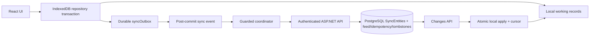

# SentinelOps Database Storage Remediation

**Date:** 2026-10-22  
**Status:** **NOT READY FOR CLOUD CUTOVER**

## Executive status

The remediation improves the local outbox lifecycle and adds an explicit, dry-run-gated cloud-import queue. It does not verify Neon, apply migrations, change production secrets, or implement typed financial aggregates. Production remains blocked pending target verification, PostgreSQL integration evidence, attachment storage, and two-device acceptance.

## Confirmed baseline

- **Repository verified:** IndexedDB `sentinelops_db` is the local working store; the outbox is durable and mutation-local transactions are atomic.
- **Repository verified:** The API persists accepted payloads as generic JSON in `SyncEntities`, with change-feed, tombstone, idempotency, and device tables.
- **Repository verified:** EF migrations are explicit and are not applied at API startup.
- **Repository verified:** Previous local backups did not create outbox records or cloud-import operations.
- **Remote/production:** **UNVERIFIED.** No Neon credentials, deployment access, or live API checks were available.
- **Local/test database:** **NOT VERIFIED in this session.** No database-writing command was run.

## Changes implemented

### `src/storage/repositories.ts`

All outbox-backed mutations now call `requestSync()` after `tx.done`, including quotations, revisions, invoices, payments, projects, and attachment metadata. The event is best-effort; IndexedDB remains the source of truth when offline or when the event is missed.

### `src/services/backupService.ts`

Added `queueBackupForCloudImport`. It:

- Runs the existing dry-run analysis first.
- Rejects missing relationships and document-number collisions.
- Preserves source UUIDs.
- Queues settings, clients, quotations, revisions, invoices, payments, projects, and attachment metadata as durable outbox operations.
- Does not modify business stores.
- Does not queue local users, credentials, audit events, or attachment blobs.
- Requests normal authenticated sync only after the outbox transaction commits.

### `src/features/settings/SettingsView.tsx`

Added **Queue Cloud Import**. It requires an enrolled device, a clean dry run, and explicit confirmation. Existing full restore and local merge behavior remains unchanged.

### `tests/cloudImport.test.ts`

Added tests proving clean backups queue without changing business stores and unsafe relationship data is rejected before queueing.

### Operational documentation

Added:

- `docs/operations/database-target-verification.md`
- `docs/operations/local-to-cloud-import.md`
- `docs/operations/production-database-deploy.md`

These distinguish repository, local/test, and remote/production evidence and contain no secrets.

## Real storage lifecycle after remediation

Client and settings already triggered immediate sync; all other supported outbox-backed mutations now do as well. Attachment bytes, audit events, local users, and authentication material remain local-only.

## Verification

Passed:

- `npm run lint`
- `npm test -- --run tests/cloudImport.test.ts tests/outbox.test.ts tests/migrations.test.ts`
- 3 test files, 10 tests passed in the focused remediation run.

Not run or not verified:

- Neon target identity, migration history, row counts, and deployed API target: **UNVERIFIED**.
- EF build/test before restore: previously blocked by missing `project.assets.json`; no restore was performed during the earlier audit.
- `dotnet ef database update`: intentionally not run.
- Production deployment/import: intentionally not run.
- PostgreSQL HTTP integration and two real browser profiles: not available in this session.

## Release gates

- [ ] Live database identity and API/CI target alignment are verified.
- [ ] Intended database has reviewed EF migration history and expected schema.
- [x] IndexedDB migration and outbox regression tests pass locally.
- [x] All current outbox-backed mutations dispatch post-commit sync notifications.
- [ ] Push/pull behavior passes real PostgreSQL integration and concurrency tests.
- [ ] Stale cursor, tombstone, snapshot, and attachment recovery are complete.
- [ ] Typed financial persistence or an explicitly approved generic contract is production-tested.
- [x] Initial import has a dry-run-gated, idempotent outbox queue path; server reconciliation and rollback remain unverified.
- [ ] Attachment binary synchronization is complete, or attachment workflows remain blocked cross-device.
- [ ] Production backup restore and two-device acceptance pass.
- [x] Frontend lint and focused remediation tests pass.
- [ ] API build/tests pass in an environment with restored .NET assets.
- [ ] Production readiness is confirmed separately from local code readiness.

## Safe next operator actions

1. Follow `docs/operations/database-target-verification.md` against the confirmed Neon branch without sharing secrets.
2. Apply migrations only through the protected, approved workflow after backup and target confirmation.
3. Enroll a staging tablet and create a synthetic client; verify its `SyncEntities` row and pull into a second profile.
4. Export and preserve tablet backups, then use the new Settings dry run and **Queue Cloud Import** action for staging only.
5. Do not import real business data or declare cloud cutover until PostgreSQL integration, backup restore, attachment, and two-device gates pass.
