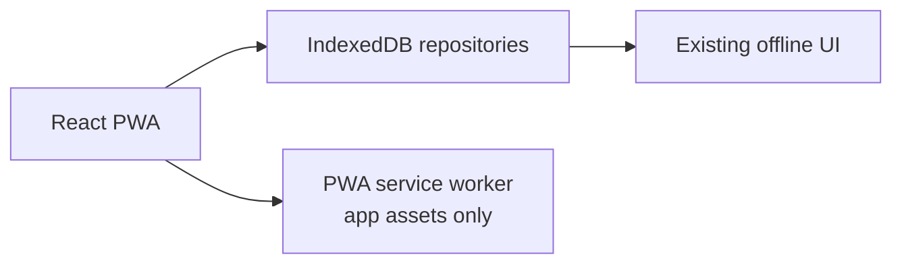
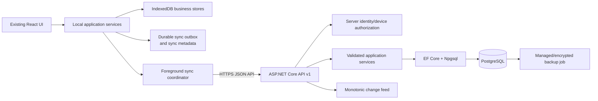

# SentinelOps Phase 2 Architecture and Sync Design

Status: incremental implementation. The server foundation and a constrained authenticated sync vertical slice are present; full domain-resource synchronization, attachment transfer, migration tooling, and end-to-end device verification remain outstanding.

## 1. Read-only audit

Verified from the current repository:

- The client is a React 19 + TypeScript + Vite PWA. The production service worker caches app assets only.
- All business data is in IndexedDB database `sentinelops_db`, schema version 1, through `src/storage/database.ts` and `src/storage/repositories.ts`.
- Stores are `users`, `settings`, `numberSequences`, `clients`, `quotations`, `quotationRevisions`, `invoices`, `payments`, `projects`, `attachments`, and `auditEvents`.
- IDs are UUID strings generated in the browser. Human-readable quotation, invoice, payment, and project numbers are allocated locally by a year/prefix sequence and can collide across devices.
- Payment recording and reversal update related financial records in one IndexedDB transaction. Audit events are written afterward in a separate operation.
- Quotations retain revision snapshots; projects retain progress notes in the project record; attachments retain metadata and a browser `Blob` in IndexedDB.
- Local authentication stores a browser-only user record with PBKDF2 password/security-answer hashes. This record, the local password hash, session state, and encryption material must never be synchronized.
- Existing JSON/ZIP backup and restore remains a separate device portability path. Restore currently replaces business stores after validation.
- The server contains an ASP.NET Core `net10.0` API, EF Core/Npgsql migrations, health endpoints, device registration protected by `Sync:RegistrationToken`, and authenticated tenant-scoped push/pull metadata synchronization. The current slice stores generic entity payloads and is not yet the complete domain-resource API.
- The environment has .NET SDK 10.0.401 and Docker, but no `psql` client. PostgreSQL integration must therefore use a container or CI service for verification.

## 2. Current and target architecture





The PWA remains usable when the API is unavailable. The service worker is not used for API data or credentials.

## 2.1 Evidence matrix (2026-10-20)

| Requirement area | Status | Evidence and verification | Remaining action |
| --- | --- | --- | --- |
| ASP.NET Core, EF Core, PostgreSQL migrations | Partially fulfilled | `server/SentinelOps.Api`, Npgsql configuration, two migrations; `dotnet build` and four unit tests pass | Run migrations and API integration tests against PostgreSQL in CI |
| Device authentication and tenant scoping | Partially fulfilled | Hashed registration tokens, revoked-device query, business-scoped feed and entities | Add credential expiry/rotation, explicit revocation endpoint, and integration attack tests |
| Push idempotency and validation | Partially fulfilled | Transactional idempotency records, bounded batches, per-operation results; entity allowlist and payload limits are enforced | Wire local mutations to atomic outbox writes and add PostgreSQL duplicate/retry tests |
| Pull ordering, cursors, and tombstones | Partially fulfilled | Opaque monotonic sequence cursor, bounded paging, retained tombstones; stale resurrection is rejected | Implement retention-aware full resync and atomic IndexedDB apply-plus-cursor transactions |
| Conflict and financial integrity | Not fulfilled | Generic revision checks exist, but domain-specific invoice/payment/issued-document rules are not server-enforced | Implement domain aggregates and append-only financial commands before production sync |
| Attachments | Not fulfilled | Local attachment metadata/blob export exists; no authenticated server transfer | Add private storage, checksum/size/type validation, and resumable transfer |
| Local-to-server migration | Not fulfilled | Device JSON/ZIP backup/restore is separate from sync | Add dry-run mapping, validation, duplicate reporting, and recoverable import |
| Centralized backup and restore | Not fulfilled | `server/docker-compose.yml` provisions PostgreSQL only | Define encrypted backup/retention/restore automation and test restoration |
| Two-device and PostgreSQL end-to-end verification | Not fulfilled | CI builds/tests the API and frontend but does not exercise HTTP sync or two profiles | Add PostgreSQL-backed API integration and browser/device-profile tests |
| Deployment and operations | Partially fulfilled | CI, environment-based connection string, explicit CORS, health endpoints, and rate limiting | Document TLS termination, migrations, monitoring, backup RPO/RTO, and lost-device recovery |

The frontend `npm test`, `npm run lint`, and `npm run build` commands pass. These results verify compilation and existing unit behavior only; they do not establish synchronization correctness or production deployment.

## 3. Entity mapping and initial scope

| IndexedDB record | API DTO/resource | PostgreSQL aggregate | Initial policy |
| --- | --- | --- | --- |
| Client | `ClientDto` | `clients` | Optimistic concurrency; unresolved edits become conflicts |
| Quotation | `QuotationDto` | `quotations` | Draft revisions and base-revision checks |
| QuotationRevision | `QuotationRevisionDto` | `quotation_revisions` | Append-only immutable snapshot |
| Invoice | `InvoiceDto` | `invoices` | Issued financial facts immutable; amendment/void commands only |
| Payment | `PaymentDto` | `payments` | Append-only; reversal is a separate command |
| Project | `ProjectDto` | `projects` | Version checks; progress notes append-only |
| ProjectProgressNote | `ProjectProgressNoteDto` | `project_progress_notes` | Append-only stable UUID |
| AttachmentMetadata | `AttachmentMetadataDto` | `attachments` | Metadata first; bytes deferred behind private upload API |
| AuditEvent | `AuditEventDto` | `audit_events` | Server audit plus imported local audit reference |
| AppSettings | `SettingsDto` | `business_settings` | Explicit allowlist; no local auth/security fields |
| LocalUser | none | none | Never synchronized |
| Blob bytes | private attachment object | object storage/filesystem abstraction | Deferred until authenticated metadata flow is verified |

Every server row is scoped by `business_id`. Client-provided business IDs are never trusted for authorization.

## 4. Database and identity plan

- Use UUID primary keys for synchronized entities and separate unique `(business_id, document_type, document_number)` constraints for human-readable numbers.
- Use UTC `created_at`/`updated_at` values and a server-generated `revision_id` or integer `row_version` for optimistic concurrency.
- Add `change_sequence bigint generated from a business-scoped sequence` to change-feed records. The API exposes it as an opaque cursor.
- Retain deletion tombstones in `change_feed`/`entity_tombstones` until the retention policy allows compaction.
- Add indexes for `(business_id, id)`, `(business_id, updated_at)`, foreign keys, `(business_id, change_sequence)`, and document-number uniqueness.
- Use EF Core migrations in source control. Migrations are applied as a controlled deployment step, not implicitly on API startup in production.
- Initial server scope is clients, projects, quotations/revisions, invoices, payments/reversals, progress notes, settings allowlist, audit events, and sync metadata. Attachment byte transfer is explicitly deferred until its private storage provider is selected.

## 5. Versioned sync protocol

API prefix: `/api/v1`.

### Push

`POST /api/v1/sync/push` accepts a bounded batch:

```json
{
  "deviceId": "uuid",
  "operations": [
    {
      "operationId": "uuid",
      "entityType": "Client",
      "entityId": "uuid",
      "operation": "upsert",
      "baseRevision": "opaque-server-revision-or-null",
      "payload": {}
    }
  ]
}
```

The server authenticates the user/device and business scope, validates each operation, checks `operationId` in an idempotency table, verifies the base revision, applies the business update plus idempotency record plus change-feed row plus audit row in one database transaction, and returns one result per operation. Results are `accepted`, `already_applied`, `rejected`, `unauthorized`, or `conflict`.

Timeouts retry the same operation ID. A client never marks an outbox item acknowledged merely because a request was sent or because another operation succeeded.

### Pull

`GET /api/v1/sync/changes?cursor=<opaque>&limit=<bounded>` returns ordered changes and `nextCursor`. The cursor advances locally only after the batch is applied to IndexedDB in the same transaction as the sync metadata update. Replaying a batch is idempotent by entity revision/change sequence. Deletes are tombstones, not immediate hard deletes.

If a cursor is older than retention, the API returns a resync-required response. The client keeps local pending writes, exports a backup, downloads a scoped snapshot, applies it transactionally, and replays pending operations through normal push conflict checks.

### Local outbox

Add stores in a later IndexedDB migration: `syncOutbox`, `syncMetadata`, `syncConflicts`, and `syncDevices`. A successful local mutation and its outbox command should be committed in one transaction where the repository owns both writes. Ordinary mutable edits may coalesce by entity only when no financially significant command is lost. Payments, reversals, issued documents, revisions, deletes, and attachment metadata operations are never coalesced away.

## 6. Conflict policy

- Clients: reject stale base revisions and preserve local/server versions for explicit resolution.
- Quotation drafts: reject stale base revisions; create immutable revisions for issued/superseded documents.
- Issued quotations and invoices: no in-place financial overwrite; use controlled revision, amendment, or void commands.
- Payments: append-only accepted payment operation; reversal is a separate idempotent operation. Never merge or retry as a new payment ID.
- Projects/settings: optimistic version checks and explicit conflict resolution for meaningful fields.
- Progress notes and audit events: append-only stable IDs.
- Attachments: metadata conflict plus checksum/size verification; a record is not fully synchronized until bytes are uploaded and verified.

Visible document-number collisions are reconciled explicitly. A server-issued number is allocated before issue/external sharing; an offline draft retains its stable UUID and local display number until reconciliation. Issued numbers are never silently renumbered.

## 7. Authentication, authorization, and security

Server identity is separate from the local vault password. The server uses ASP.NET Core Identity-compatible password hashing and short-lived authenticated sessions. The preferred browser topology is an HTTPS same-site deployment using `HttpOnly`, `Secure`, `SameSite=Lax` cookies with antiforgery protection for state-changing requests. If static PWA and API are cross-site, use a documented short-lived access/refresh design with explicit XSS and revocation tradeoffs; never place long-lived tokens in localStorage or IndexedDB by default.

Each device is registered and revocable. Every query and mutation resolves business scope from the authenticated server principal and device association. CORS is restricted to configured PWA origins. Login, refresh, device registration, and push endpoints are rate-limited. Production errors do not expose stack traces or database details; logs exclude tokens, passwords, hashes, keys, and business payloads.

Phase 1 PBKDF2 local authentication and local encrypted-data behavior remain unchanged. TLS protects transport and database encryption protects storage, but neither is end-to-end encryption. The initial server design assumes the API can read synchronized business fields; this trust boundary requires owner/security review before production.

## 8. Migration and recovery

1. Export a JSON/ZIP backup from each tablet and preserve the originals.
2. Validate schema version, counts, required fields, UUIDs, relationships, document numbers, monetary integer-centavo values, timestamps, and attachment metadata in a dry run.
3. Produce accepted/rejected/duplicate/conflict reports without mutating the source tablet.
4. Import idempotently into a staging business scope, preserving source IDs and local audit references.
5. Compare counts, totals, relationships, and representative records before approval.
6. Keep local-only and pending records visible until server confirmation; do not cut over by clearing IndexedDB.
7. Roll back by retaining the source tablet backup and discarding only the staging business scope if validation fails.

Central backup is separate from sync: configure encrypted managed PostgreSQL backups, off-instance retention, failure alerting, and a periodic restore into an isolated database. Proposed owner-approved targets are RPO 24 hours and RTO 4 hours for the first deployment; these are not yet configured or verified.

## 9. Implementation milestones and acceptance gates

- A: this audit/design document. Complete only as design; no sync claim.
- B: API project, PostgreSQL EF model, initial migration, health endpoints, error envelope, local compose configuration, and CI build/test/migration validation. Validation and structured operational logging still need completion before this milestone is closed.
- C: server identity, business/device authorization, rate limits, CORS, antiforgery, and security tests.
- D: IndexedDB outbox/metadata migration, typed API client, push/pull coordinator, retries, tombstones, conflicts, and status UI.
- E: synchronize clients/projects first, then quotations/revisions, then invoices/payments with financial tests.
- F: dry-run migration/import and attachment metadata; attachment byte transfer only after private storage is selected.
- G: backup/restore configuration and a witnessed restore drill.
- H: two independent browser profiles, offline transitions, conflict, retry/idempotency, migration, and restore verification.

No milestone may claim production readiness until API tests, PostgreSQL integration tests, two-profile synchronization, and backup restoration have passed in a controlled environment.
